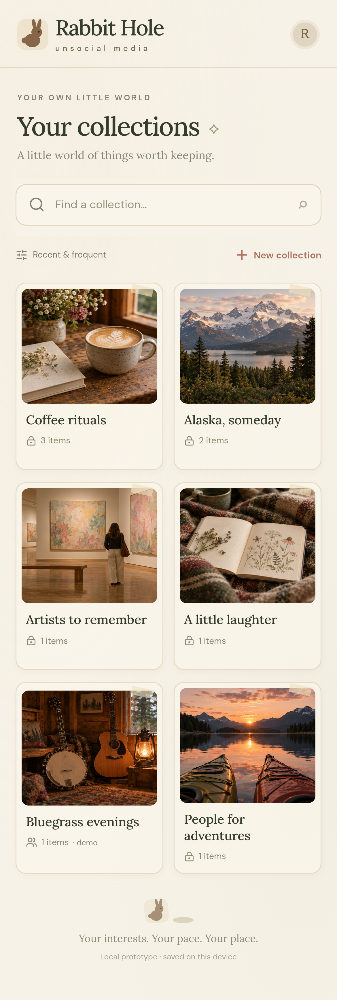

# Rabbit Hole

_unsocial media_

Rabbit Hole is a personal home for things worth remembering: art, music, useful links, jokes, people, places, and events. Collections help you find those things again and explore a subject intentionally.

This repository is a phone-first web starter. It uses React, TypeScript, and Vite, with an early interactive interface and local demo data. It is a starting point for development, not a production social network.



## Run locally

Use Node.js 24 (see `.nvmrc`) and npm.

```sh
npm ci
npm run dev
```

Open the local address printed by Vite. To access the development server from a cloud preview, run:

```sh
npm run dev -- --host 0.0.0.0
```

The starter can run without an account, API keys, or a database. Browser-local data is specific to that browser and is not a backup or a sync service. Resetting site storage removes it.

## Checks

```sh
npm run typecheck
npm run lint
npm test
npm run build
```

For browser checks, install Playwright's Chromium browser once, then run the suite:

```sh
npm exec -- playwright install --with-deps chromium
npm run test:e2e
```

For this cloud environment, an installed system browser can be used with `PLAYWRIGHT_CHROMIUM_EXECUTABLE_PATH=/usr/bin/chromium npm run test:e2e`.

GitHub Actions runs the project checks, browser suite, and database permission tests. `npm run preview` serves the production build locally after `npm run build`.

## Product direction

- Your collections are the opening page, ordered by recent and frequent use.
- Collection pages open on **Saved**, alongside **Discover** and **Create** tabs.
- Saved items use a scrollable, two-column photo grid with a persistent collection search.
- Saving requires at least one collection. Collections also serve as tags, and an item can belong to several.
- Collections are private by default, with public and link-only sharing planned.
- Locations and dates unlock map and calendar views; standalone map pins are part of the design.
- The visual direction is warm and playful: cream paper, botanical details, soft colors, serif headings, and subtle rabbit illustrations. Cards inside collections stay simple.

See [the product decisions](docs/product.md) for the agreed behavior and [the architecture notes](docs/architecture.md) for implementation boundaries and next steps.

## What still needs a backend

Map view currently lists saved locations; interactive map tiles and dropping pins are next steps. The calendar is a dated agenda, with manually entered events.

The starter does not provide live internet search or imports, real recommendations, accounts, synchronized storage, contributor invitations, publication, external calendar sync, or event-update monitoring. Sample discovery content and event information should be treated as demonstration data.

Supabase migration scaffolding provides a direction for persistent data and permissions. It is separate from the local demo and does not establish a running backend. See [the database setup and permission checks](supabase/README.md) before connecting a Supabase project.

Keep credentials out of the repository. A browser environment variable prefixed with `VITE_` is public to users of the app; server secrets must never be placed there.

## Repository layout

| Location    | Purpose                                                           |
| ----------- | ----------------------------------------------------------------- |
| `src/`      | Application, demo data, local state helpers, and unit tests       |
| `public/`   | Static visual assets                                              |
| `e2e/`      | Phone-sized Chromium user-flow tests                              |
| `supabase/` | Optional database configuration, migration, and permission checks |
| `docs/`     | Product decisions and architecture direction                      |
| `.github/`  | Continuous integration and pull-request template                  |

## Development

Use the existing checkout; each cloud task already has an isolated environment. Read [AGENTS.md](AGENTS.md) before making changes. Commit source files and the npm lockfile; leave generated builds, dependencies, local credentials, and Playwright reports untracked.
